

  <b>Deutsch</b> · <a href="https://github.com/lSi0270/Awesome-Theme-Collection/blob/main/README_en.md"><b>English</b></a>

# Awesome Theme Kollektion

Das ist eine Kollektion von UIX-Themes mit passenden Hintergründen für Home Assistant. Die Themes stylen (fast) alle HA-Standard-Karten, Custom-Karten, Bubble-Karten und Mushroom-Karten mit einem einheitlichen Aussehen.

Zusätzlich werden alle Seiten (Einstellungen, Profile usw.), Dialoge, Bubble-Card-Popups, Abschnitte, Seitenleiste, Kopfleiste mit einem Bild-Hintergrund versehen. 

Die Themes nutzen alle das gleiche Farbschema, unterscheiden sich beim Kartenstyling, mit Schatten oder Ohne und der Wahl des Hintergrundes.

Zusätzlich können in den Integrations-Einstellungen noch nachträgliche Anpassungen vorgenommen werden, um die Themes noch weiter an den persönlichen Geschmack anzupassen.

[Installation](#installationsanweisungen) · [Einstellungen](#einstellungen) · [Änderungen](#änderungen) · [English](#awesome-theme-collection)

## Enthaltene Themes

- Awesome-Metal-Shadows-UIX

  
  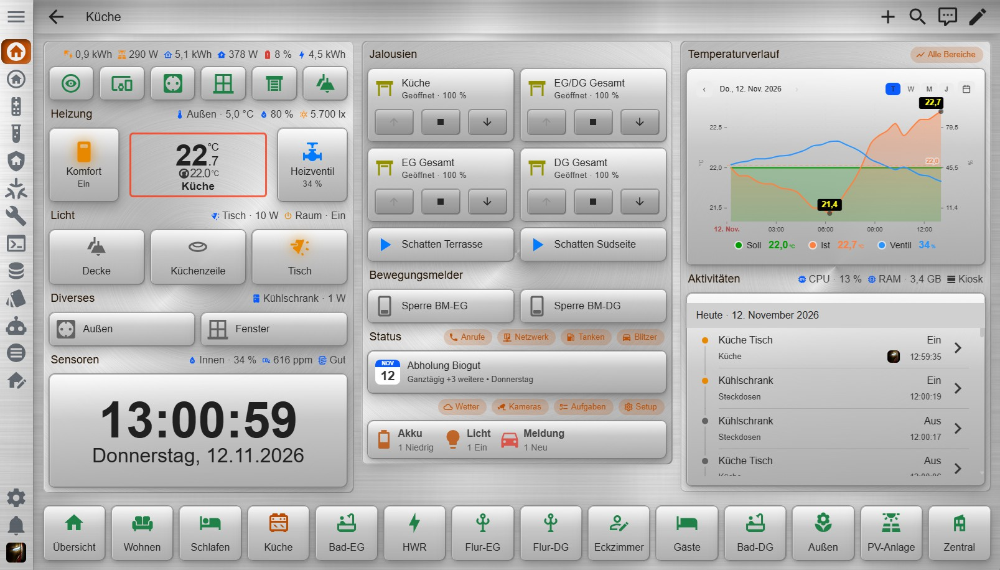

- Awesome-Metal-UIX

  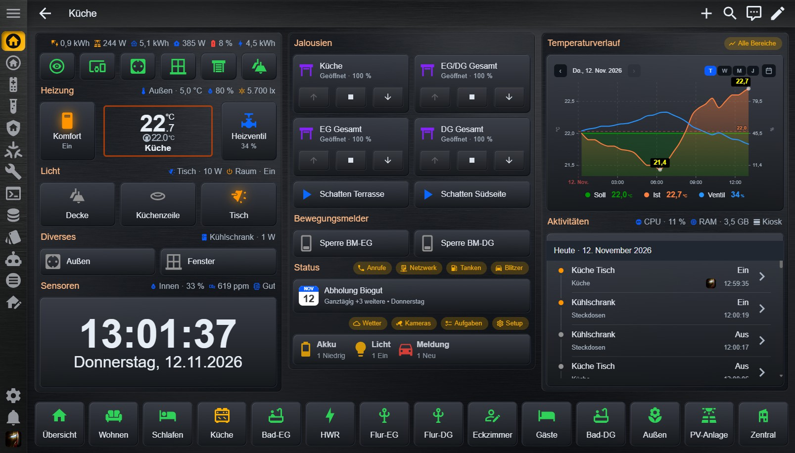
  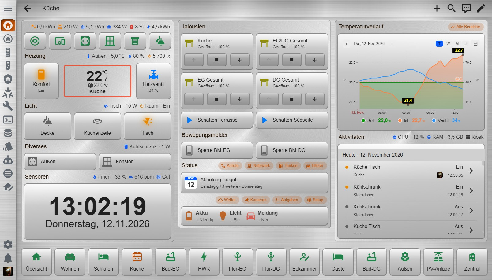

- Awesome-Leather-Shadows-UIX

  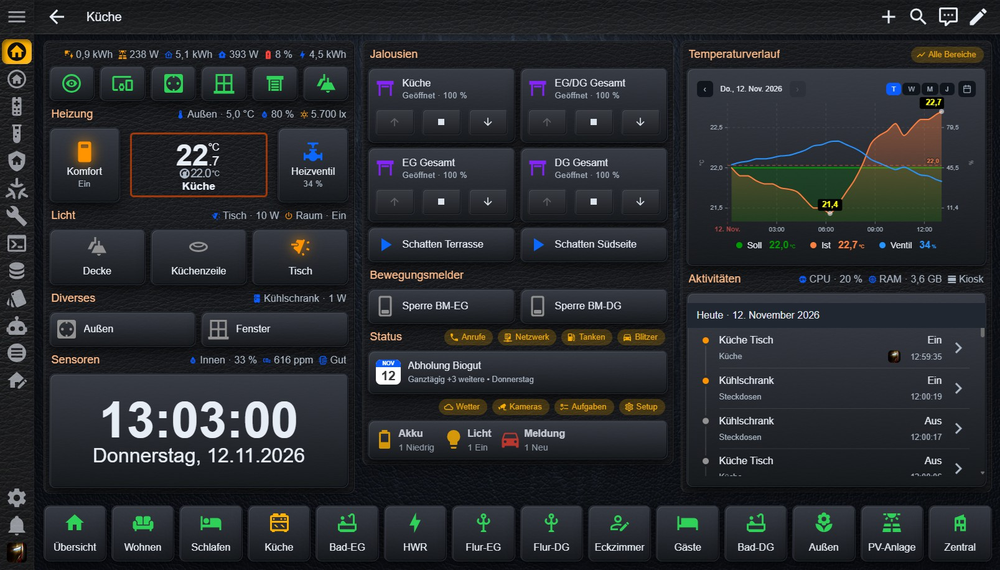
  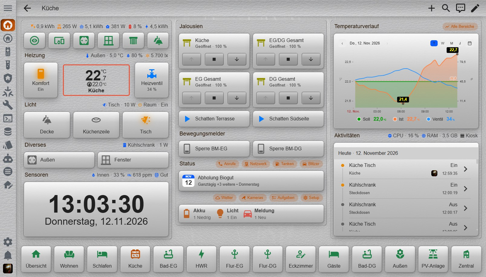

- Awesome-Leather-UIX

  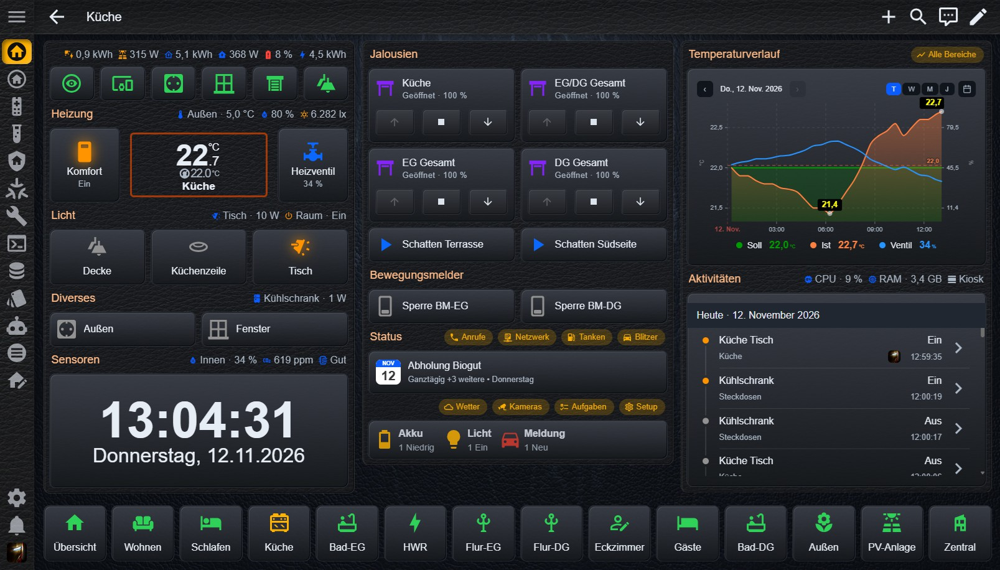
  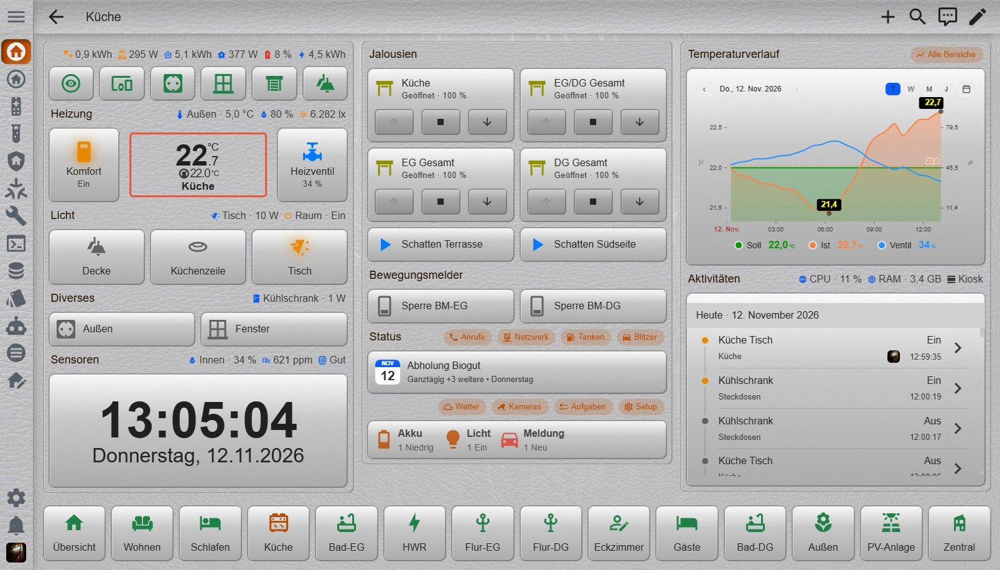

- Awesome-Flat-Metal-Shadows-UIX

  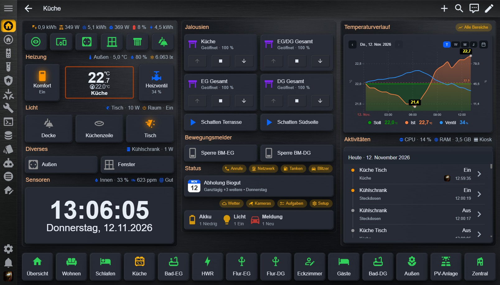
  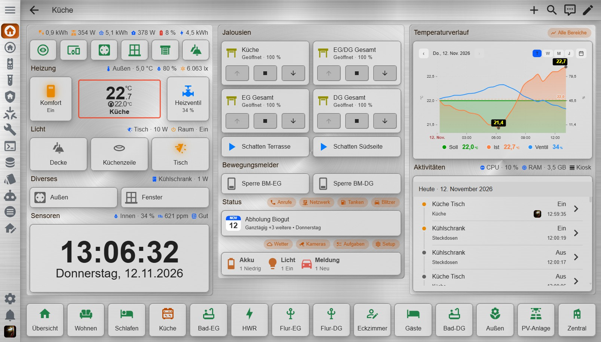

- Awesome-Flat-Metal-UIX

  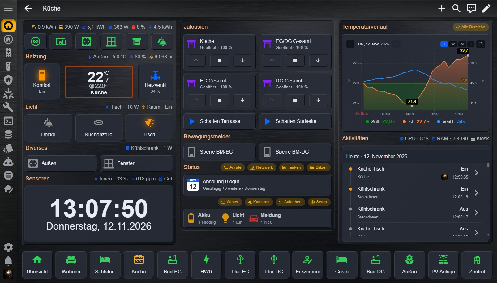
  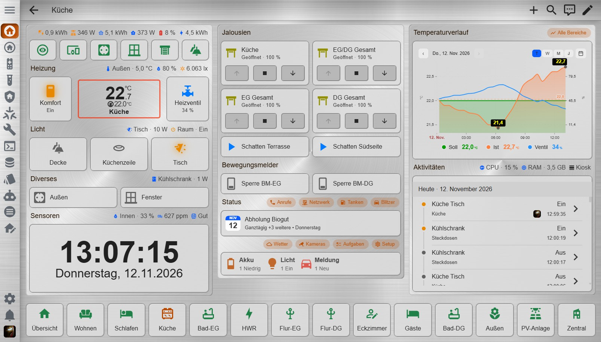

- Awesome-Flat-Leather-Shadows-UIX

  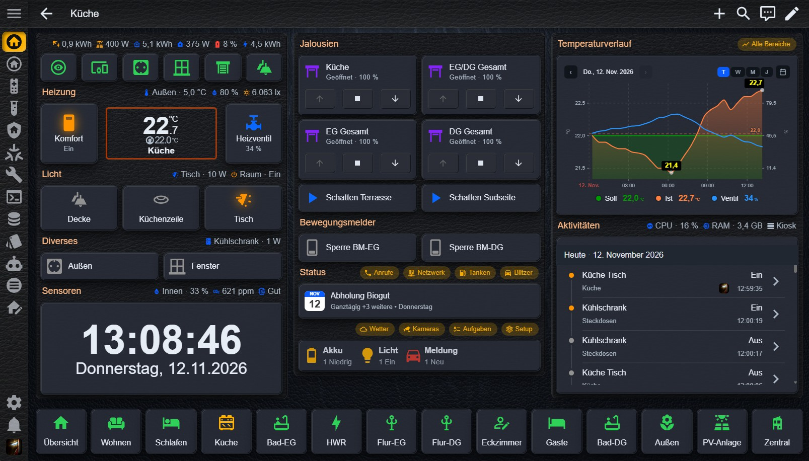
  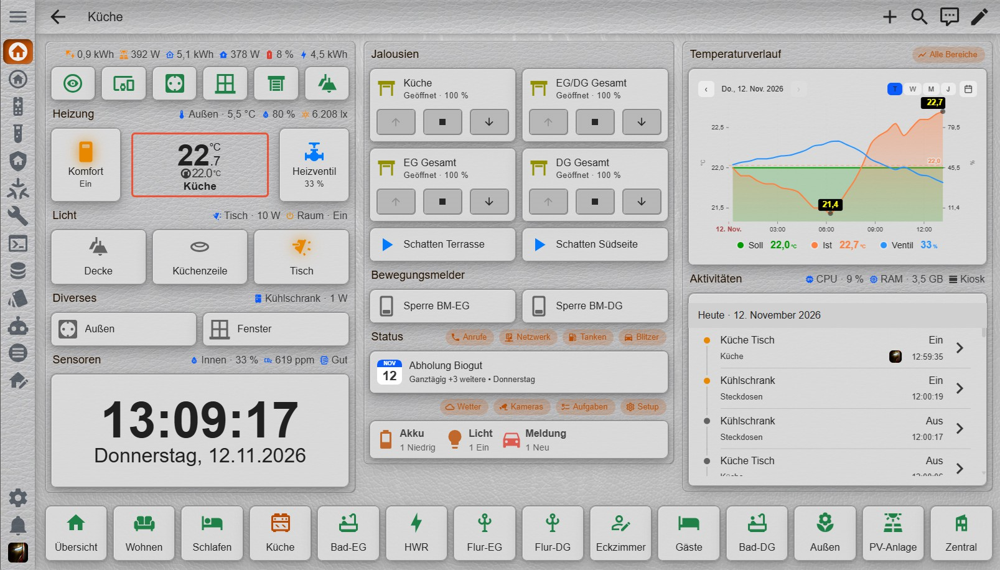

- Awesome-Flat-Leather-UIX

  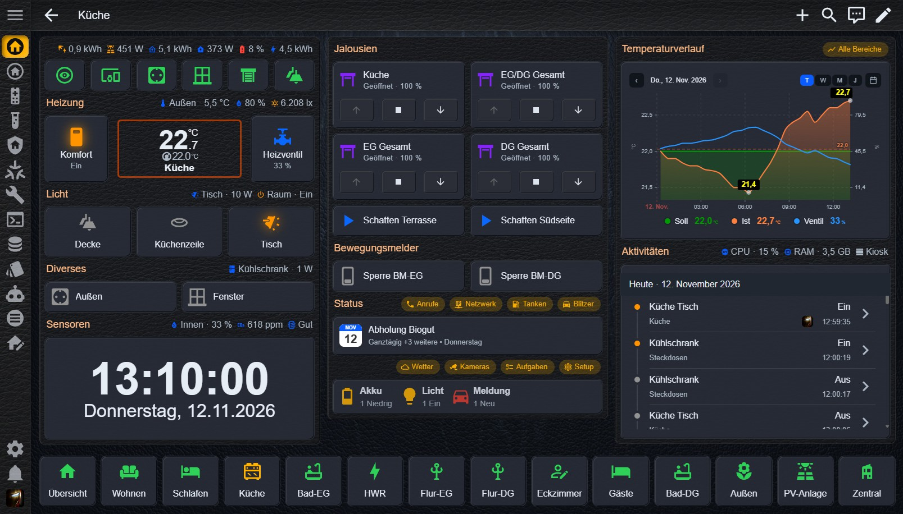
  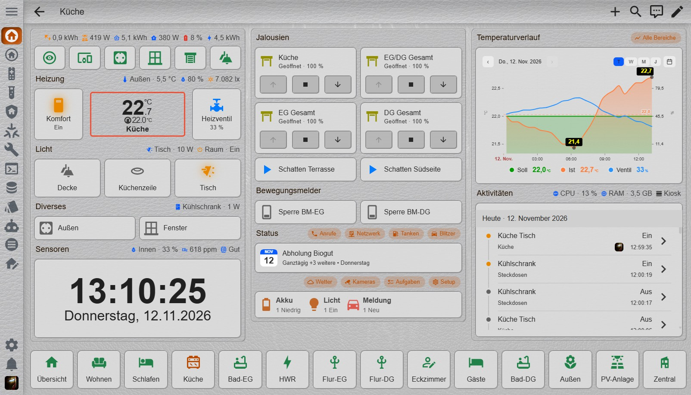

Für die Nutzung ist es erforderlich, das die Themes beim Start von Home Assistant geladen werden (siehe [Installationsanweisungen](#installationsanweisungen)). 

Da die Themes intensiven Gebrauch von der UIX-Erweiterung machen, ist es für das vorgesehene Aussehen erforderlich das die UIX-Erweiterung installiert ist (siehe Installationsanweisungen).
Ohne UIX funktioniert es auch, aber sieht dann nur nach einem Standard-HA-Theme mit anderer Farbpalette aus. Die Themes richten sich an Alle die nicht alles von Hand stylen wollen, aber trotzdem ein schönes, gleichmäßiges Aussehen haben wollen.

Besonderer Dank geht an Piranha1605 für seinen HATG (https://github.com/Piranha1605/ha-theme-generator) und Lint-Free-Technology für die UIX-Erweiterung (https://github.com/Lint-Free-Technology/uix).
Ohne die Beiden wäre die Themes-Kollektion nicht enstanden.

[🏠 Anfang](#awesome-theme-kollektion)

## Installationsanweisungen

Bitte gehen Sie die folgenden Schritte genau durch, um eine reibungslose Funktion zu gewährleisten !

### 1. Home Assistant Konfiguration

- Die Integration modifiziert mit Absicht **nicht** deine `configuration.yaml`. Deshalb muss der folgende Eintrag auch selbst von Hand erledigt werden. Wenn der Eintrag bereits vorhanden ist, bitte zu 2. springen.

Damit Home Assistant die installierten Themes auch nutzen kann, füge Folgendes deiner `configuration.yaml` hinzu:

    frontend:
      themes: !include_dir_merge_named themes

- Nach der Änderung der `configuration.yaml`, Home Assistant neu starten.

### 2. UIX-Erweiterung installieren

- Wenn die UIX-Erweiterung bereits installiert ist und die UIX-Einstellungen in "Experimental settings" gemacht sind, bitte zu 3. springen.

- Im Marketplace nach `uix` suchen und die UIX-Erweiterung (`https://github.com/Lint-Free-Technology/uix`) installieren.

-  Integration öffnen und dann auf das "Zahnrad" (Konfigurieren) klicken.

- `Experimental settings` auswählen und `Always patch ha-card` und `Style frame panels loaded as iframe` anhaken (notwendig damit alle Teile des Themes auch so funktionieren wie sie sollen)

### 3. Installation der Awesome Theme Kollektion

  

oder

1. **Awesome Theme Collection** im Marketplace suchen.
2. Integration herunterladen und installieren ("Designs neu laden" wird nach der Installation automatisch ausgeführt).
3. In den Integrations-Einstellungen können diverse [Einstellungen](einstellungen) gemacht werden.
4. Zu **Profil** (Benutzer) und unter "Design" das gewünschte Design auswählen und den gewünschten "Design-Modus" 

Die Integration legt automatisch die erforderlichen Verzeichnisse an für die Themes (`/config/themes/`) und für die Hintergründe (`/config/www/wallpaper/`).

### 4. Spaß haben

Ich hoffe es zumindest, das es dem Einen oder Anderen auch so gut gefällt wie mir selbst.

[🏠 Anfang](#awesome-theme-kollektion)

## Einstellungen

In den Integration-Einstellungen könne diverse Modifikationen vorgenommen werden. Es gibt 3 Untermenüs.

- Bereiche aktivieren/deaktivieren
- Awesome-Metall-Themes
- Awesome-Leder-Themes

Eine Auswähl öffnet das passende Dialogfenster.

## Bereiche aktivieren/deaktivieren

- Hier kann ein ganzer Themen-Bereich aktiviert/deaktiviert werden. Das heisst wenn **"Awesome-Metall-Themes" oder "Awesome-Leder-Themes"** deaktiviert wird, werden alle passenden Themes und Hintergrundbilder dazu deaktiviert (aus öffentlichen Bereich entfernt).

- Die Themes und Hintergründe werden nach Aktivierung wieder freigegeben, das heisst Sie werden bei Deaktivierung nicht komplett gelöscht und sind in den Integration-Einstellungen jederzeit wieder verfügbar (solange die Integration nicht deinstalliert wird).

## Awesome-Metall-Themes

Hier werden alle Einstellungen die die Metall-Themes betreffen gemacht und sind unabhängig von den anderen Bereichen.

### Auswahl

- Hier können einzelne **Themes aus diesem Bereich aktiviert/deaktiviert werden.** Dabei werden nur die Themes aus dem öffentlichen Bereich entfernt. Die passenden Hintergründe bleiben für die anderen Themes verfügbar.

### Hintergründe

- Hier können die **Bild- und Farb-Hintergründe für Dashboard- und Popup-Hintergrund (Dialoge, Bubble-Card Popups)** eingestellt werden (oder auch eine Kombination von Beiden).

- Es stehen alle Bilder die in `/config/www/wallpaper/` hinterlegt sind zur Verfügung. Das heisst man kann auch eigene Bilder in das Verzeichnis kopieren, die dann in der jeweiligen Auswahl vorhanden sind.
Ich habe bereits ein paar **zusätzliche Hintergründe zur Auswahl** hinzugefügt (Passend mit _dark und _light gekennzeichnet).

- Unterteilt ist der Bereich in **"Dashboard" und "Popups"** mit je einer Bild- und Farbauswahl für **"Dunkel" und "Hell"-Modus**.

- z.B. "Dashboard-Bild-Dunkel" und "Dashboard-Farbe-Dunkel" stellt den Dashboard-Bild-Hintergrund und Dashboard-Farb-Hintergrund für den "Dunkel"-Design-Modus zusammen. Die beiden Werte werden dabei immer kombiniert.
Das Gleiche gilt auch für die anderen Felder im gleichen Maße.

- Es kann unter der Bildauswahl auch "Transparent" ausgewählt werden (wenn kein Bildhintergrund gewünscht). Alternativ kann in den rgba-Werten der Alpha auf 1 gesetzt werden (Farbe dann 100% deckend).

**Farbwert und Linear-Grandient nur verändern wenn man weiss was man tut, da ich nicht garantieren kann ob wirklich alle Falscheingaben abgefangen werden.**

**Wenn ein Linear-Gradient-Generator verwendet wird, bitte nur den eigentlichen Gradienten kopieren. Das heisst ohne "background: " am Anfang und ohne ";" am Ende, da sonst der Wert als ungültig abgelehnt wird.**

- Es ist nur **ein Linear-Gradient erlaubt**, allerdings sind auch **mehr Zwischenwerte möglich** sowie auch ein anderer Winkel für den Verlauf und Prozent-Positionen.
Damit sind aber schon ziemlich viele wilde Kombinationen aus Bild- und Farb-Hintergrund möglich.

- Beachten Sie bei der Wahl des Hintergrund-Bildes und der Hintergrund-Farbe darauf das die Lesbarkeit weiterhin gegeben ist (wählen sie deshalb nur zum Bereich passende Bilder und Farben aus).

- Übernommen werden die Änderungen mit **"OK"**. Wenn etwas Falsches eingegeben wurde kommt eine "rote Fehlermeldung" im Dialog und der Wert wird wieder auf den Standard-Wert gesetzt.

Wenn **"Auf Standard-Hintergründe zurücksetzen"** aktiviert ist werden **mit "OK" die Voreinstellungen wieder hergestellt für die Bildhintergründe.**

Wenn **"Auf Standard-Farben zurücksetzen"** aktiviert ist werden mit **"OK" die Voreinstellungen wieder hergestellt für die Farbwerte.**

*Alle Einstellungen gelten hier nur für alle Hintergründe und Farben der Metall-Themes.*

### Abschnitte

- Hier können die Abschnittsabstände für **horizontale und vertikale Abstände der Abschnitte** eingestellt werden. Es sind Werte zwischen 0-50px möglich. Ich würde aber nicht empfehlen die Werte auf 0 zu setzen, da dann die Abschnitte direkt aneinander liegen.

- Außerdem kann eine **Rahmenfarbe** festgelegt werden.
  Die Rahmenfarbe ist aber nur aktiv wenn für den jeweiligen Abschnitt ein Hintergrund festgelegt ist.

- Es kann ein **Bild- und Farb-Hintergrund für Abschnitte** festgelegt werden. Es stehen alle Bilder aus dem "wallpaper"- Verzeichnis zur Verfügung. Wenn kein Bild-Hintergrund gewünscht ist entweder "Transparent" als Bild auswählen oder die Deckung im Linear-Gradient auf 1 ändern.
  Als Farb-Hintergrund kann ein Linear-Gradient (auch mit mehr Zwischenwerten) eingestellt werden. 
  Beide Hintergrund-Felder gibt es jeweils für den Dunkel- und Hell-Modus.

- Mit dem **Schalter "Hintergund immer aktiv"** auf "Ein" wird immer hinter jeden Abschnitt ein Bild- und Farbhintergrund gelegt, auch wenn in den Abschnitts-Einstellungen kein Hintergrund eingestellt ist.

Übernommen werden die Änderungen mit **"OK"**. Wenn etwas Falsches eingegeben wurde kommt eine "rote Fehlermeldung" im Dialog und der Wert wird wieder auf den Standard-Wert gesetzt.

Wenn **"Auf Standard zurücksetzen"** aktiviert ist werden **mit "OK" die Voreinstellungen wieder hergestellt in diesem Bereich.**

### Karten

- Hier kann der **Karten-Radius für alle Karten** eingestellt werden. Das gilt für alle HA-Karten, Bubble-Karten, Mushroom-Karten und sonstige Custom-Karten. Das sorgt für ein einheitliches Kartendesign. Bubble-Karten haben normalerweise einen deutlich stärkeren Radius (28px).
Wenn man das so möchte kann man alle anderen Karten auch darauf anpassen.

- **Bedienelemente mit Karten-Hintergrund** bewirkt das auch die Bedienelemente (Cover-Control-Buttons, Bubble-Sub- Control-Buttons, Mushroom-Control-Buttons) den Karten-Style bekommen.

Wenn **"Auf Standard zurücksetzen"** aktiviert ist werden **mit "OK" die Voreinstellungen wieder hergestellt in diesem Bereich.**

### Seitenleiste

Für die Seitenleiste (Sidebar) sind folgende Einstellmöglichkeiten vorhanden.

- **Eigener Titel** im Kopf der Seiteleiste einstellen (Standard: Home Assistant). Es sind max. 20 Zeichen erlaubt.

- **Schriftgröße für Einträge** die nicht ausgewählt sind (Standard: 18px) und Schriftgröße für den ausgewählten Eintrag (Standard: 20px). Einstellbar von 14px - 24px.

- **Schriftfarbe für Einträge** die nicht ausgewählt sind im den Dunkel-Modus und Schriftfarbe für den ausgewählten Eintrag im Dunkel-Modus.

- Schriftfarbe für Einträge die nicht ausgewählt sind im den Hell-Modus und Schriftfarbe für den ausgewählten Eintrag im Hell-Modus.

- **Bild- und Farbhintergrund im Dunkel-Modus** (es gelten die gleichen Bedingungen wie bei den anderen Feldern zur Auswahl des Bild- und Farbhintergrundes)

- **Bild- und Farbhintergrund im Hell-Modus** (es gelten die gleichen Bedingungen wie bei den anderen Feldern zur Auswahl des Bild- und Farbhintergrundes)

- die ausgewählten Hintergründe werden automatisch auch für die Benachrichtigungen-Seite benutzt

Wenn **"Auf Standard zurücksetzen"** aktiviert ist werden **mit "OK" die Voreinstellungen wieder hergestellt in diesem Bereich.**

### Kopfleiste

Für die Kopfleiste (Header-Toolbar) sind folgende Einstellmöglichkeiten vorhanden.

- **Schriftgröße für Einträge** die nicht ausgewählt sind (Standard: 18px) und Schriftgröße für den ausgewählten Eintrag (Standard: 20px). Einstellbar von 14px - 24px.

- **Schriftfarbe für Einträge** die nicht ausgewählt sind im den Dunkel-Modus und Schriftfarbe für den ausgewählten Eintrag im Dunkel-Modus.

- Schriftfarbe für Einträge die nicht ausgewählt sind im den Hell-Modus und Schriftfarbe für den ausgewählten Eintrag im Hell-Modus.

- **Bild- und Farbhintergrund im Dunkel-Modus** (es gelten die gleichen Bedingungen wie bei den anderen Feldern zur Auswahl des Bild- und Farbhintergrundes)

- **Bild- und Farbhintergrund im Hell-Modus** (es gelten die gleichen Bedingungen wie bei den anderen Feldern zur Auswahl des Bild- und Farbhintergrundes)

Wenn **"Auf Standard zurücksetzen"** aktiviert ist werden **mit "OK" die Voreinstellungen wieder hergestellt in diesem Bereich.**

### Icons

- Hier kann die **Icon-Größe und die Icon-Farbe** (wenn aus/deaktiviert) eingestellt werden. Das gilt z.B. für die Entitäten-Icons, Seitenleiste-Icons, Kopfleiste-Icons, Formular-Icons.

- Die Größe kann zwischen 16 - 36px (Standard: 24px) gewählt werden. Bei Knopf-Karten wird nur die Minimal-Größe auf die eingestellte Icon-Größe verändert, da Knopf-Karten die Icon-Größe abhängig von der Größe der Karte dynamisch anpassen.

- Der Schalter **"Icons mit Leuchtschein"** bewirkt das alle Icons mit dem Status "An" einen Leuchtschein (Glow) in der Zustand-Farbe bekommen z.B. eingeschaltete Lampen, Steckdosen, Schalter usw.

- Die **Icon-Farbe** gilt nur im aus-/deaktiertem Zustand und kann für den Dunkel- und Hell-Modus getrennt eingestellt werden.

Wenn **"Auf Standard zurücksetzen"** aktiviert ist werden **mit "OK" die Voreinstellungen wieder hergestellt in diesem Bereich.**

### Schrift - Größen

- Hier können **die global geltenden Schriftgrößen** eingestellt werden. Überall wo diese Standard-Schriftgrößen verwendet werden, wird die eingestellte Schriftgröße übernommen.
Zulässig sind Werten zwischen 8 - 46px (**bei zu groß gewählten Größen kann es zu Darstellungsproblemen kommen**)

Die Standards und Verwendungszweck sind: 
- font-size-xs (Kleine Statusanzeigen, kurze Hinweise, kompakte Labels), font-size-s (Sekundärtexte, Untertitel, Zeitstempel, kleine Beschriftungen),
- font-size-m (Normaler Text, Standardbeschriftungen, Entitätsnamen), font-size-l (Hervorgehobener Text, wichtige Statusinformationen, Kartenüberschriften)
- font-size-xl (Größere Überschriften, Abschnittstitel), font-size-2xl (Hauptüberschriften, prominente Werte)
- font-size-3xl (Große Überschriften, wichtige Messwerte), font-size-4xl (Sehr große Kennzahlen, Temperatur oder Energieverbrauch)
- font-size-5xl (Besonders prominente Zahlen, z. B. auf einem Wandtablet)

Wenn **"Auf Standard zurücksetzen"** aktiviert ist werden **mit "OK" die Voreinstellungen wieder hergestellt in diesem Bereich.**

### Schrift - Farben

- Hier können **die global geltenden Schriftfarben** eingestellt werden. Überall wo diese Standard-Farben genutzt werden, wird die eingestellte Farbe übernommen.
Der Bereich ist in die Farben für den Dunkel-Modus und den Hell-Modus unterteilt. **Ändere die Farben nur so dass sie noch lesbar bleiben.**

- Einstellbar ist die Primär-Text-Farbe (z.B. Bezeichnungen), Sekundär-Text-Farbe (z.B. Statusmeldungen), Deaktiviert-Text-Farbe, Überschriften-Text-Farbe (z.B. Überschriften von Abschnitten)
Der Bereich ist in 2 Gruppen unterteilt. Einmal die 4 einstellbaren Farben für den Dunkel-Modus und dann die 4 einstellbaren Farben für den Hell-Modus.

Wenn **"Auf Standard zurücksetzen"** aktiviert ist werden **mit "OK" die Voreinstellungen wieder hergestellt in diesem Bereich.**

### Primär-Farben

- Hier können die **Primär- und Aktenzfarbe** angepasst werden (für Dunkel- und Hell-Modus). Die Primärfarbe wird z.B. für Rahmen und Hintergründe bestimmter Bedienelemente verwendet. Die Aktenzfarbe wird z.B. für Bestimmte Schalter oder aktive Elemente. verwendet.

*Alle Einstellungen gelten hier nur für alle  Abschnitte der Metall-Themes.*

## Awesome-Leder-Themes

Alle Einstellungen sind die Gleichen wie im Awesome-Metall-Themes Bereich. Siehe [**Awesome-Metall-Themes**](#awesome-metall-themes)

*Alle Einstellungen gelten hier nur für alle Leder-Themes.*

[🏠 Anfang](#awesome-theme-kollektion)

## Support

- Wenn dir meine Arbeit gefällt, hinterlasse einen ⭐ auf Github in meinem Repository.
- Wenn du ein Problem findest oder einen Verbesserungsvorschlag hast, öffne eine Issue im Github Repository.

## Änderungen

v1.3.0

Weitere neue persönliche Einstellmöglichkeiten sind dazu gekommen:

- Im Bereich "Abschnitte" kann ein Bild- und Farbhintergrund (Linear-Gradient) für die Abschnitte festgelegt werden. Getrennt für den Dunkel- und Hell-Modus.
   Der Schalter "Hintergrund immer aktiv" bewirkt das immer ein Hintergrund hinter jeden Abschnitt gelegt wird, auch wenn in den Einstellungen des Abschnitts kein Hintergrund ausgewählt ist.
   
 - Im neuen Bereich "Karten" wird jetzt der global geltene Karten-Radius eingestellt (alle HA-Karten, Bubble-Karten, Mushroom-Karten und sonstige Custom-Karten). Aussdem gibt es einen neuen Schalter "Bedienelemente mit Kartenhintergrund" der wie der Name schon sagt den Kartenhintergrund auch hinter die Bedienelemente legt (z.B. Cover-Controls, Bubble-Sub-Buttons, Mushroom-Control-Buttons)
 
- Im neuen Bereich "Seitenleiste" (Sidebar) können folgende Einstellungen gemacht werden. 
   1. Eigenen Titel im Kopf festlegen (anstatt "Home Assistant"). 
   2. Die Schriftgröße für die Einträge (nicht ausgewählt/ausgewählt getrennt).
   3. Die Textfarbe für die Einträge (nicht ausgewählt/ausgewählt getrennt) jeweils für Dunkel- und Hell-Modus.
   4. Einen Bild- und Farb-Hintergrund (Linear-Gradient) für die Seitenleiste jeweils für Dunkel- und Hell-Modus.
   
- Im neuen Bereich "Kopfleiste" (Header-Toolbar) können folgende Einstellungen gemacht werden. 
   1. Die Schriftgröße für die Einträge (nicht ausgewählt/ausgewählt getrennt).
   2. Die Textfarbe für die Einträge (nicht ausgewählt/ausgewählt getrennt) jeweils für Dunkel- und Hell-Modus.
   3. Einen Bild- und Farb-Hintergrund (Linear-Gradient) für die Kopfleiste jeweils für Dunkel- und Hell-Modus.

- die ausgewählten Seitenleiste-Hintergründe werden automatisch auch für die Benachrichtigungen-Seite benutzt

- Im Bereich Icons gibt es einen neuen Schalter "Icons mit Leuchtschein" der bewirkt das Icons mit Status "An" einen Leuchtschein in Zustandsfarbe bekommen z.B. eingeschaltete Lampen, Steckdosen, Schalter usw.

v1.2.0

Die persönlichen Einstellmöglichkeiten wurden nochmal deutlich erweitert:

- es können die Standard-Schriftgrößen verändert werden (font-size-xs, font-size-s, font-size-m, font-size-l, font-size-xl, font-size-2xl, font-size-3xl, font-size-4xl, font-size-5xl),
  überall wo diese Standards verwendet werden wird die Schriftgröße angepasst. Wenn die Schriftgröße zu groß gewählt wurde für den Verwendungszweck kann es zu Darstellungsproblemen kommen.

- es können die Standard-Schriftfarben verändert werden (Primär-Text-Farbe, Sekundär-Text-Farbe, Deaktiviert-Text-Farbe, Überschriften-Text-Farbe)
   diese Standard-Farben werden z.B. bei Bezeichnungen (Primär-Text-Farbe) oder für Statusmeldungen (Sekundär-Text-Farbe) verwendet. Die Überschriftenfarbe z.B. für Abschnittsüberschriften.
   
- es kann die Icon-Größe und die Icon-Farbe (wenn aus/deaktiviert) für Dunkel- und Hell-Modus angepasst werden.
  Die Icon-Größe wird überall genutzt wo der Standard-Icon (ha-icon) genutzt wird z.B. bei Kachel-Karten, Seitenleiste, Kopfleiste, Formulare. Der einstellbare Bereich liegt zwischen 16 - 36px (Standard: 24px).
  
- die Mushroom-Karten und Bubble-Karten übernehmen jetzt auch die Schriftgrößen und Schriftart des Standards für die HA-Karten.

- für die Seitenleiste wurde die Schriftgröße für die Bezeichnungen jetzt von font-size-m auf font-size-l geändert (besser lesbar), auch die Schriftgröße für die Meldungsanzahl (Badge) wurde vergrößert

- es können die Primär- und Akzentfarbe angepasst werden (jeweils für Dunkel- und Hell-Modus)

- es kann der Karten-Radius zwischen 0 - 28px (Standard: 10px) eingestellt werden. Das betrifft alle HA-Karten, Bubble-Karten, Mushroom-Karten und sonstige Custom-Karten die sich im Design anpassen lassen.
  Gleichzeitig passen sich auch die Bedienelemente (Sub-Buttons usw.) an den gewählten Radius automatisch an.

- bei der Deinstallation der Integration werden jetzt alle Dateien tatsächlich entfernt

- Die Awesome-Theme-Collection ist jetzt auch im HACS-/Marketplace-Katalog zu finden
 

v1.1.0
- es sind jetzt andere (auch eigene) Bildhintergründe möglich (einstellbar über die Integrations-Einstellungen) getrennt für die Metall- und Leder-Themes,
  getrennt für Dashboard und Popups (HA-Dialoge, Bubble-Card-Popups) jeweils für "Hell" und "Dunkel"-Modus. 
  (eigene Bilder nach /config/www/wallpaper/ kopieren) Ich habe bereits ein paar zusätzliche Hintergründe zur Auswahl hinzugefügt (Passend mit _dark und _light gekennzeichnet).

- ausserdem sind mehrstufige Farbverläufe möglich als Hintergrund, getrennt für Dashboard und Popups (HA-Dialoge, Bubble-Card-Popups) jeweils für "Hell" und "Dunkel"-Modus. 
  Der Bildhintergrund kann zusätzlich dazu erhalten bleiben, wenn im Farbverlauf eine Alphawert kleiner 1 gesetzt ist oder ein optional auswählbarer transparenter Hintergrund gewählt wurde.

- zusätzlich kann jeweils ein ganzer Bereich an Themes deaktiviert werden (Metall- und Leder-Themes), die aber nur aus dem öffentlichen Bereich entfernt werden und jederzeit wieder reaktiviert werden können

- neu ist auch ein zusätzlicher Bereich in dem die Abschnittsabstände und Rahmenfarbe für Abschnitte in beiden Theme-Bereichen getrennt einstellbar ist

- es sind noch mehr System-Dialoge mit dem Theme-Styling versehen

v1.0.5
- setzt einen dezenten Rand für Abschnitte wenn Hintergrund gesetzt

- state-active-color (light) korrigiert

v1.0.4
- Auswahlmöglichkeit der Themes in den Integrations-Einstellungen

- keine Fehlermeldungen mehr im Log nach Neustart

- "Designs neu laden" wird jetzt automatisch ausgeführt nach Installation/Deinstallation

v1.0.3
- Neuer Metallhintergrund

- Screenshots aktualisiert

v1.0.2
- mehr Farben korrigiert, Transparenzwerte teilweise angepasst, mehr Dialoge mit Dashboard-Hintergrund

v1.0.1
- Einige Farben korrigiert für HA-Karten, Bubble-Karten, Mushroom-Karten

v1.0.0
- Erstes Release (8 UIX-Themes mit Light & Dark Sektion)

[🏠 Anfang](#awesome-theme-kollektion)

# Awesome Theme Collection

This is a collection of UIX themes with matching backgrounds for Home Assistant. The themes style (almost) all standard HA cards, custom cards, bubble cards and mushroom cards with a consistent look.

In addition, all pages (settings, profiles, etc.), dialogue boxes, bubble card pop-ups, sections, the sidebar and the header toolbar will be given an image background.

The themes all use the same color scheme but differ in terms of card styling – with or without shadows – and the choice of background.

In addition, further adjustments can be made in the integration settings to tailor the themes even more closely to your personal taste.

[Installation](#installation-instructions) · [Settings](#settings) · [Changes](#changes)
## Included Themes

- Awesome-Metal-Shadows-UIX

  
  

- Awesome-Metal-UIX

  
  

- Awesome-Leather-Shadows-UIX

  
  

- Awesome-Leather-UIX

  
  

- Awesome-Flat-Metal-Shadows-UIX

  
  

- Awesome-Flat-Metal-UIX

  
  

- Awesome-Flat-Leather-Shadows-UIX

  
  

- Awesome-Flat-Leather-UIX

  
  

To use them, the themes must be loaded when Home Assistant starts (see [installation instructions](#installation-instructions)).

As the themes make extensive use of the UIX extension, the UIX extension must be installed to achieve the intended look (see installation instructions).
It will work without UIX, but will then simply look like a standard HA theme with a different color scheme. The themes are aimed at anyone who doesn’t want to style everything manually but still wants an attractive, consistent look.

Special thanks go to Piranha1605 for his HATG (https://github.com/Piranha1605/ha-theme-generator) and Lint-Free-Technology for the UIX extension (https://github.com/Lint-Free-Technology/uix).
Without them, this collection of themes would never become reality.

[🏠 Home](#awesome-theme-collection)

## Installation instructions

Please follow the steps below carefully to ensure everything works smoothly!

### 1. Home Assistant configuration

- The integration is deliberately designed **not** to modify your `configuration.yaml`. You must therefore add the following entry manually. If the entry already exists, please skip to step 2.
To ensure Home Assistant can use the installed themes, add the following to your `configuration.yaml`:

    frontend:
      themes: !include_dir_merge_named themes

- After changing `configuration.yaml`, restart Home Assistant.

### 2. Install the UIX extension

- If the UIX extension is already installed and the UIX settings have been configured under ‘Experimental settings’, please skip to step 3.

- Search for `uix` in the Marketplace and install the UIX extension (`https://github.com/Lint-Free-Technology/uix`).

- Open Integration and then click on the ‘cog’ (Configure).

- Select `Experimental settings` and tick `Always patch ha-card` and `Style frame panels loaded as iframe` (this is necessary to ensure that all parts of the theme work as they should)

### 3. Installing the Awesome Theme Collection

  

or

1. Search for **Awesome Theme Collection** in the Marketplace.
2. Download and install the integration (‘Reload themes’ will run automatically after installation).
3. Various [settings](settings) can be configured in the integration settings.
4. Go to **Profile** (User) and, under “Design”, select the desired design and the desired “Design mode”

The integration automatically creates the necessary directories for the themes (`/config/themes/`) and for the wallpapers (`/config/www/wallpaper/`).

### 4. Have fun

I certainly hope that some of you will enjoy it as much as I do.

[🏠 Home](#awesome-theme-collection)

## Settings

Various changes can be made in the integration settings. There are 3 sub-menus.

- Enable/disable sections
- Awesome Metal Themes
- Awesome Leather Themes

Selecting an option opens the corresponding dialog box.

## Enable/disable sections

- Here, an entire theme section can be enabled or disabled. This means that if **‘Awesome Metal Themes’ or ‘Awesome Leather Themes’** is disabled, all corresponding themes and background images will be disabled (removed from the public area).

- The themes and backgrounds are made available again once enabled; this means they are not completely deleted when disabled and remain available at any time in the integration settings (provided the integration is not uninstalled).

## Awesome Metal Themes

All settings relating to the metal themes are configured here and are independent of the other sections.

### Selection

- Here, individual **themes from this section can be enabled or disabled.** Only the themes are removed from the public area. The corresponding background images remain available for the other themes.

### Backgrounds

- Here you can set the **image and color backgrounds for the dashboard and pop-up backgrounds (dialogs, bubble card pop-ups)** (or a combination of both).

- All images stored in `/config/www/wallpaper/` are available. This means you can also copy your own images into this directory, which will then appear in the relevant selection.
I’ve already added a **few extra backgrounds to the selection** (labelled _dark and _light as appropriate).

- The section is divided into **“Dashboard” and “Pop-ups”**, each with an image and color selection for **“Dark” and “Light”-Mode**.

- For example, “Dashboard Image – Dark” and “Dashboard Color – Dark” combine the dashboard image background and dashboard color background for the “Dark” design mode. These two settings are always combined.
The same applies to the other fields in exactly the same way.

- Under ‘Image selection’, you can also choose ‘Transparent’ (if you do not want a background image). Alternatively, you can set the alpha value to 1 in the rgba values (the color will then be 100% opaque).

**Only change the color value and linear gradient if you know what you’re doing, as I cannot guarantee that all incorrect entries will be caught.**

**If you are using a linear gradient generator, please copy only the gradient itself. That is, without ‘background: ’ at the start and without ‘;’ at the end, as otherwise the value will be rejected as invalid.**

- Only **one linear gradient is permitted**, although **more intermediate values are possible**, as well as a different angle for the gradient and percentage positions.
This already allows for quite a few wild combinations of image and color backgrounds.

- When choosing the background image and background color, please ensure that readability is maintained (therefore, only select images and colors that are suitable for the area).

- The changes are applied by clicking **‘OK’**. If an incorrect value is entered, a "red error message" appears in the dialog box and the value is reset to its default value.

If **‘Reset to default backgrounds’** is enabled, **clicking ‘OK’ will restore the default settings for image backgrounds.**

If **"Reset to default colors"** is enabled, **clicking "OK" will restore the default settings for the color values.**

*All settings here apply only to the backgrounds and colors of the metal themes.*

### Sections

- Here you can set the section spacing for **horizontal and vertical spacing between sections** . Values between 0–50px are possible. However, I would not recommend setting the values to 0, as the sections will then be right up against one another.

- You can also specify a border color.
**However, the border color is only active if a background has been set for the relevant section.**

- You can set an **image and color background for sections**. All images from the ‘wallpaper’ directory are available. If you do not wish to use an image background, either select ‘Transparent’ as the image or set the opacity in the linear gradient to 1.
  A linear gradient (including one with multiple intermediate values) can be set as the color background.
  Both background fields are available for both dark and light mode.

- If the **'Background always active' switch** is set to 'On', an image or colored background will always be applied behind each section, even if no background has been set in the section settings.

Changes are applied by clicking **“OK”**. If an incorrect value is entered, a "red error message" appears in the dialog box and the value is reset to its default value.

If **“Reset to default”** is enabled, **clicking “OK” will restore the default settings in this section.**

### Cards

- Here you can set the **card radius for all cards**. This applies to all HA cards, bubble cards, mushroom cards and other custom cards. This ensures a consistent card design. Bubble cards normally have a significantly larger radius (28px).
If you wish, you can also adjust all other cards accordingly.

- **Control buttons with card background** means that the controls (cover control buttons, bubble sub-control buttons, mushroom control buttons) will also adopt the card style.

If **"Reset to default"** is enabled, **clicking "OK" will restore the default settings in this section.**

### Sidebar

The following settings are available for the sidebar.

- Set a **custom title** at the top of the sidebar (default: Home Assistant). A maximum of 20 characters is permitted.

- **Item font size** for not selected items (default: 18px) and Selected item font size (default: 20px). Adjustable from 14px to 24px.

- **Item text color** for not selected items in dark mode and Selected item text color for the selected item in dark mode.

- Item text color for not selected items in light mode and Selected item text color for the selected item in light mode.

- **Image and color background in dark mode** (the same conditions apply as for the other fields for selecting the image and color background)

- **Image and color background in light mode** (the same conditions apply as for the other fields for selecting the image and color background)

- the selected backgrounds are automatically used on the notifications page as well

If **"Reset to default"** is enabled, **clicking "OK" will restore the default settings in this section.**

### Header Toolbar

The following settings are available for the header toolbar.

- **Item font size** for not selected items (default: 18px) and Selected item font size (default: 20px). Adjustable from 14px to 24px.

- **Item text color** for not selected items in dark mode and Selected item text color for the selected item in dark mode.

- Item text color for not selected items in light mode and Selected item text color for the selected item in light mode.

- **Image and color background in dark mode** (the same conditions apply as for the other fields for selecting the image and color background)

- **Image and color background in light mode** (the same conditions apply as for the other fields for selecting the image and color background)

If **"Reset to default"** is enabled, **clicking "OK" will restore the default settings in this section.**

### Icons

- Here you can set the **icon size and icon color** (if disabled). This applies, for example, to entity icons, sidebar icons, header bar icons and form icons.

- The size can be selected between 16 and 36px (default: 24px). For button cards, only the minimum size is adjusted to the set icon size, as button cards dynamically adjust the icon size depending on the card’s size.

- The **"Icons with a glow"** toggle causes all icons with the "On" status to have a glow in the status color, e.g. switched-on lamps, sockets, switches, etc.

- The icon color only applies when the feature is disabled and can be set separately for dark and light modes.

If **"Reset to default"** is enabled, **clicking "OK" will restore the default settings in this section.**

### Font sizes

- You can set the **global font sizes** here. Wherever these standard font sizes are used, the font size you have set will be applied.
Values between 8 and 46px are permitted (**selecting sizes that are too large may cause display issues**)

The standards and their intended uses are:
- font-size-xs (small status indicators, brief notes, compact labels), font-size-s (secondary text, subtitles, timestamps, small captions),
- font-size-m (normal text, standard labels, entity names), font-size-l (emphasised text, important status information, map headings)
- font-size-xl (larger headings, section titles), font-size-2xl (main headings, prominent values)
- font-size-3xl (large headings, important measured values), font-size-4xl (very large key figures, temperature or energy consumption)
- font-size-5xl (particularly prominent numbers, e.g. on a wall-mounted display)

If **"Reset to default"** is enabled, **clicking "OK" will restore the default settings in this section.**

### Font colors

- Here you can set the **global font colors**. Wherever these default colors are used, the color you have set will be applied.
This section is divided into colors for dark mode and light mode. **Only change the colors so that they remain legible.**

- You can set the primary-text-color (e.g. labels), secondary-text-color (e.g. status messages), disabled-text-color and heading-text-color (e.g. section headings)
This section is divided into two groups: the four customisable colors for dark mode and the four customisable colors for light mode.

If **‘Reset to default’** is enabled, **clicking ‘OK’ will restore the default settings in this section.**

### Primary colors

- Here, you can adjust the primary and accent colors (for dark and light modes). The primary color is used, for example, for the borders and backgrounds of certain control elements. The accent color is used, for example, for certain buttons or active elements.

*All settings here apply only to all sections of the Metal themes.*

## Awesome Leather Themes

All settings are the same as in the Awesome Metal Themes section. See [**Awesome Metal Themes**](#awesome-metal-themes)

*All settings here apply only to all leather themes.*

[🏠 Home](#awesome-theme-collection)

## Support

- If you like my work, please give my repository a ⭐ on GitHub.
- If you find a problem or have a suggestion for improvement, please open an issue in the GitHub repository.

## Changes

v1.3.0

Further new customisation options have been added:

- In the ‘Sections’ section, you can set an image or color background (linear gradient) for the sections. Separately for dark and light mode.
The ‘Background always active’ toggle ensures that a background is always applied behind each section, even if no background is selected in the section’s settings.

- In the new ‘Cards’ section, you can now set the global card radius (for all HA cards, bubble cards, mushroom cards and other custom cards). There is also a new toggle, ‘Controls with card background’, which, as the name suggests, places the card background behind the controls as well (e.g. cover controls, bubble sub-buttons, mushroom control buttons).

- The following settings can be configured in the new ‘Sidebar’ section.
1. Set your own title in the header (instead of ‘Home Assistant’).
2. Set the font size for the items (separately for unselected and selected items).
3. The text color for the items (separately for unselected and selected items) for both dark and light modes.
4. An image or color background (linear gradient) for the sidebar for both dark and light modes.

- The following settings can be configured in the new ‘Header’ section (Header Toolbar).
1. The font size for the items (separately for unselected and selected items).
2. The text color for the items (separately for unselected and selected items), for both dark and light modes.
3. An image and color background (linear gradient) for the header, separately for dark and light modes.

- the selected sidebar backgrounds are automatically used on the notifications page as well

- In the ‘Icons’ section, there is a new toggle ‘Icons with glow’, which causes icons with the ‘On’ status to display a glow in their status color, e.g. switched-on lamps, sockets, switches, etc.

v1.2.0

The range of personalisation options has been significantly expanded once again:

- the default font sizes can be changed (font-size-xs, font-size-s, font-size-m, font-size-l, font-size-xl, font-size-2xl, font-size-3xl, font-size-4xl, font-size-5xl),
  and the font size will be adjusted wherever these defaults are used. If the font size selected is too large for the intended purpose, this may lead to display issues.

- The standard font colors can be changed (primary-text-color, secondary-text-color, disabled-text-color, heading-text-color)
  These default colors are used, for example, for labels (primary text color) or status messages (secondary text color). The heading color is used, for example, for section headings.

- The icon size and icon color (if disabled) can be adjusted for dark and light modes.
  The icon size is used wherever the standard icon (ha-icon) is displayed, e.g. on tile cards, in the sidebar, header bar and forms. The adjustable range is between 16 and 36px (default: 24px).

- Mushroom cards and bubble cards now also adopt the font sizes and font style of the standard HA cards.

- For the sidebar, the font size for the labels has now been changed from `font-size-m` to `font-size-l` (for better readability), and the font size for the message count (badge) has also been increased.

- The primary and accent colors can be customised (for dark and light mode respectively)

- The card radius can be set between 0 and 28px (default: 10px). This applies to all ha cards, bubble cards, mushroom cards and other custom cards whose design can be customised.
  At the same time, the controls (sub-buttons, etc.) automatically adjust to the selected radius.

- When the integration is uninstalled, all files are now actually removed

- The Awesome Theme Collection can now also be found in the HACS-/Marketplace catalogue

v1.1.0
- Different image backgrounds (including your own) are now available (configurable via the integration settings), separately for the metal and leather themes,
  separately for the dashboard and pop-ups (HA dialogues, bubble card pop-ups), for both ‘Light’ and ‘Dark’ modes. 
  (copy your own images to /config/www/wallpaper/) I’ve already added a few extra backgrounds to the selection (labelled _dark and _light as appropriate).

- Multi-level color gradients are also available as backgrounds, separately for the dashboard and pop-ups (HA dialogs, bubble card pop-ups), for both ‘Light’ and ‘Dark’ modes. 
  The image background can also be retained if an alpha value of less than 1 is set in the color gradient or if an optional transparent background has been selected.

- In addition, an entire set of themes can be deactivated (Metal and Leather themes); however, these are only removed from the public area and can be reactivated at any time

- Another new feature is an additional section where the spacing between sections and the border color for sections can be set separately in both theme areas

- Even more system dialog boxes now feature theme styling

v1.0.5
- adds a subtle border to sections when a background is set

- state-active-color (light) corrected

v1.0.4
- no more error messages in the log after a restart

- "reload designs" is now carried out automatically after installation/uninstallation

v1.0.3
- new metal background

- screenshots updated

v1.0.2
- more colors fixes, transparency values partially adjusted, more dialog boxes with a dashboard background

v1.0.1
- some color fixes for HA-Cards, Bubble-Cards, Mushroom-Cards

v1.0.0
- first release (8 UIX-Themes with Light & Dark Section)

[🏠 Home](#awesome-theme-collection)
