

  <b>English</b> · <a href="https://github.com/lSi0270/Awesome-Theme-Collection/blob/main/README.md"><b>Deutsch</b></a>

# Awesome Theme Collection

This is a collection of UIX themes with matching backgrounds for Home Assistant. The themes style (almost) all standard HA cards, custom cards, bubble cards and mushroom cards with a consistent look.

In addition, all pages (settings, profiles, etc.), dialogue boxes, bubble card pop-ups, sections, the sidebar and the header toolbar will be given an image background.

The themes all use the same color scheme but differ in terms of card styling – with or without shadows – and the choice of background.

In addition, further adjustments can be made in the integration settings to tailor the themes even more closely to your personal taste.

[Installation](#installation-instructions) · [Settings](#settings) · [Changes](#changes)
## Included Themes

- Awesome-Metal-Shadows-UIX

  
  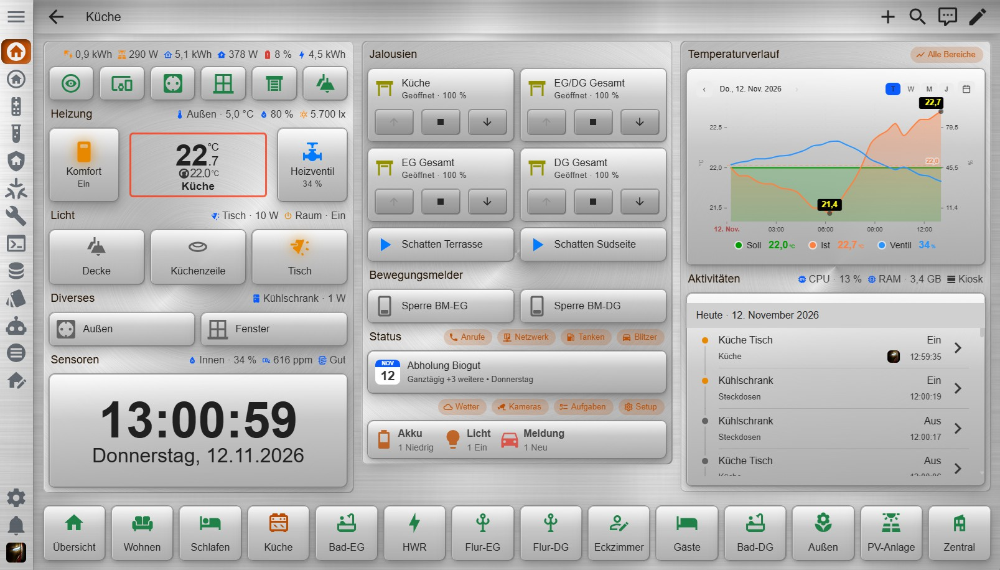

- Awesome-Metal-UIX

  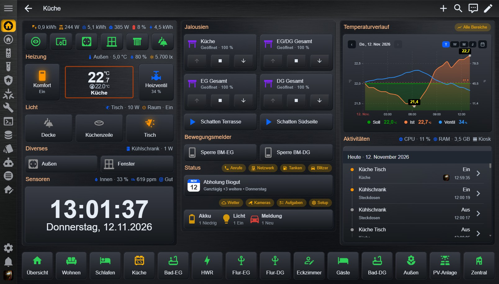
  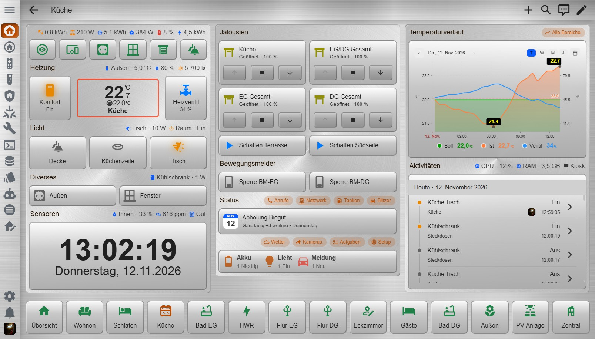

- Awesome-Leather-Shadows-UIX

  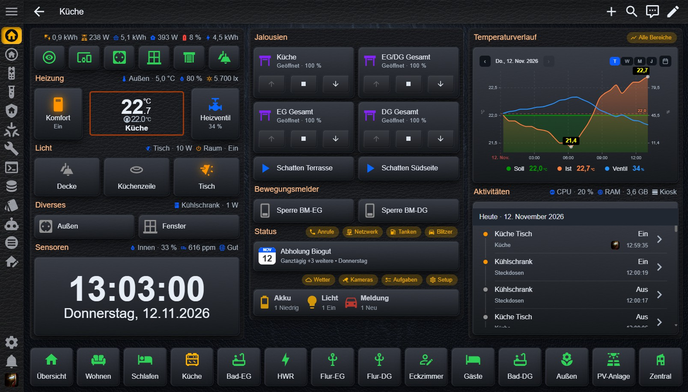
  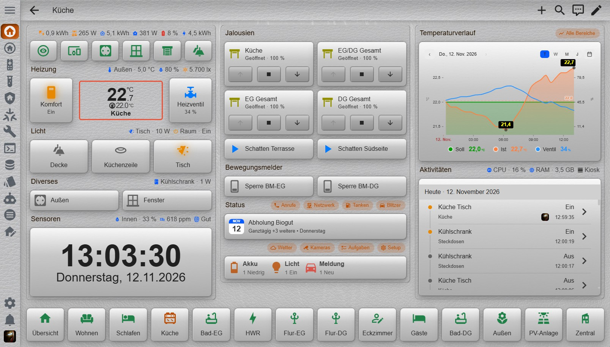

- Awesome-Leather-UIX

  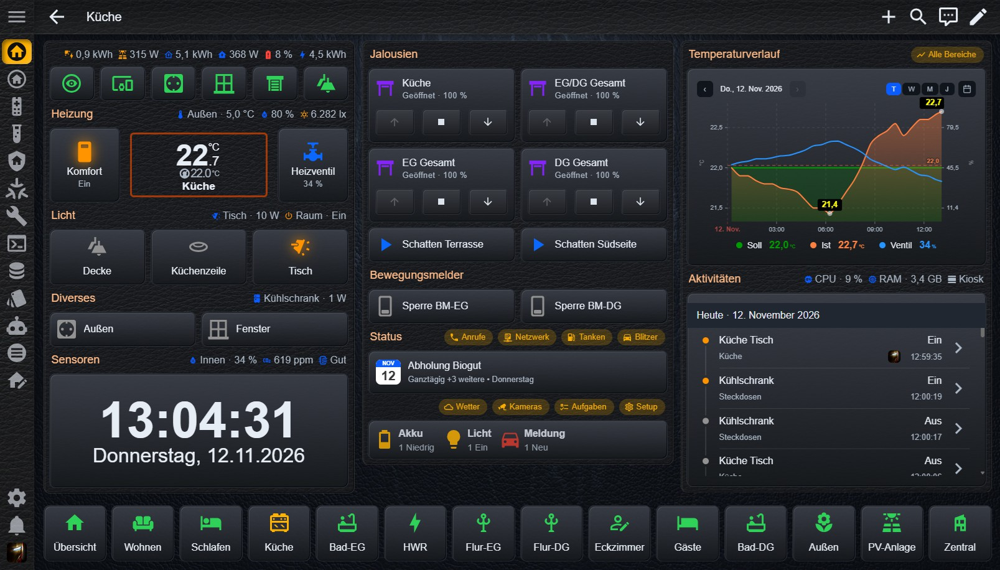
  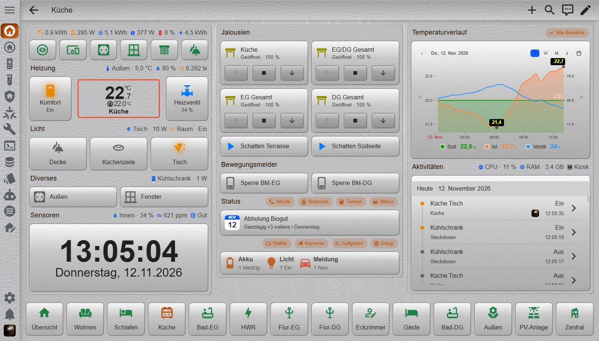

- Awesome-Flat-Metal-Shadows-UIX

  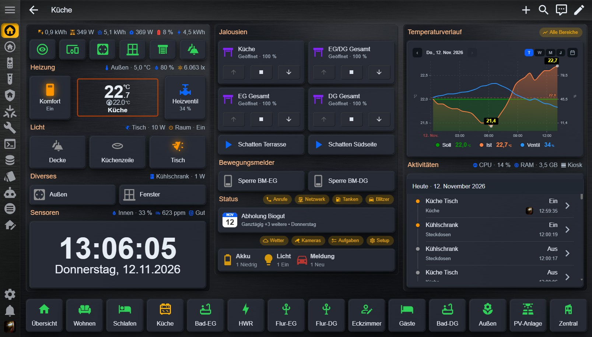
  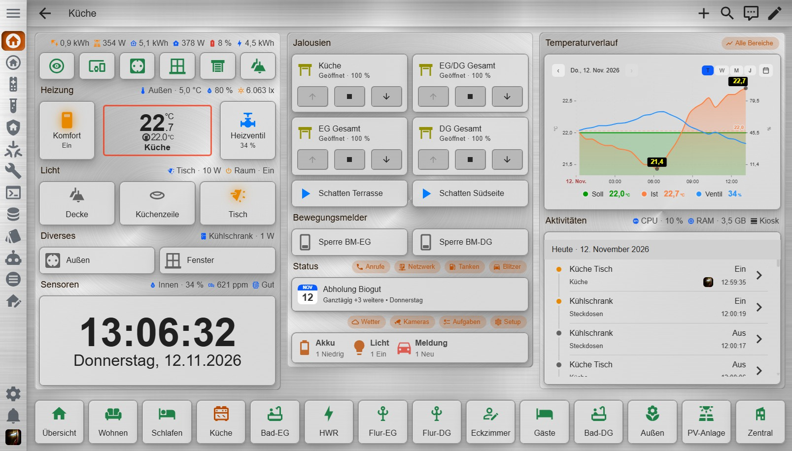

- Awesome-Flat-Metal-UIX

  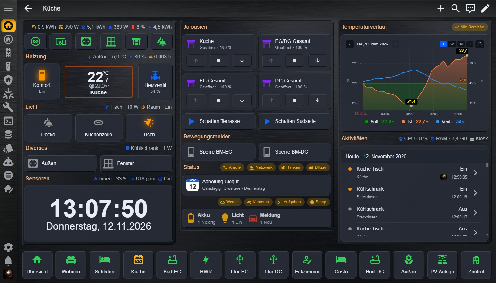
  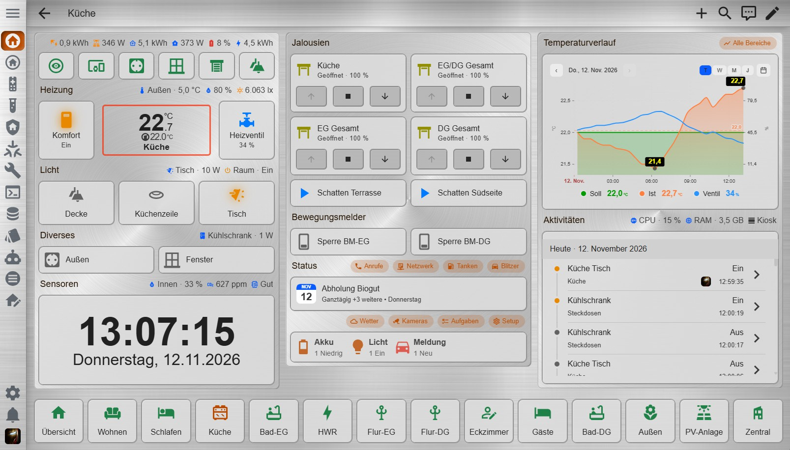

- Awesome-Flat-Leather-Shadows-UIX

  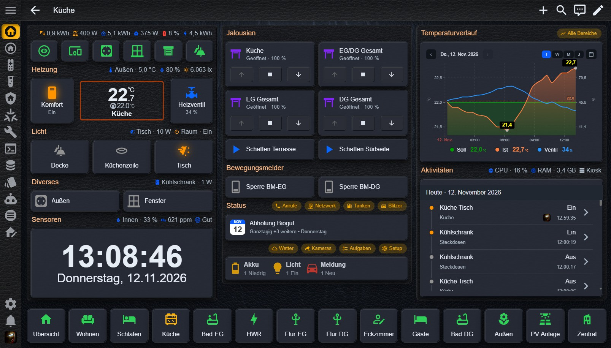
  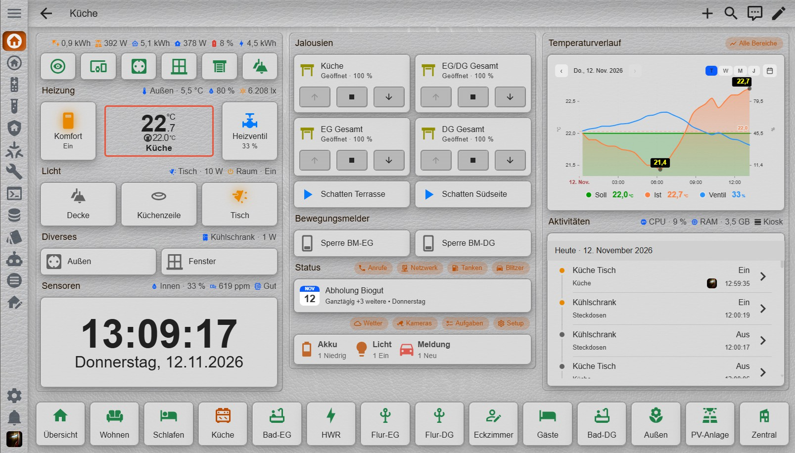

- Awesome-Flat-Leather-UIX

  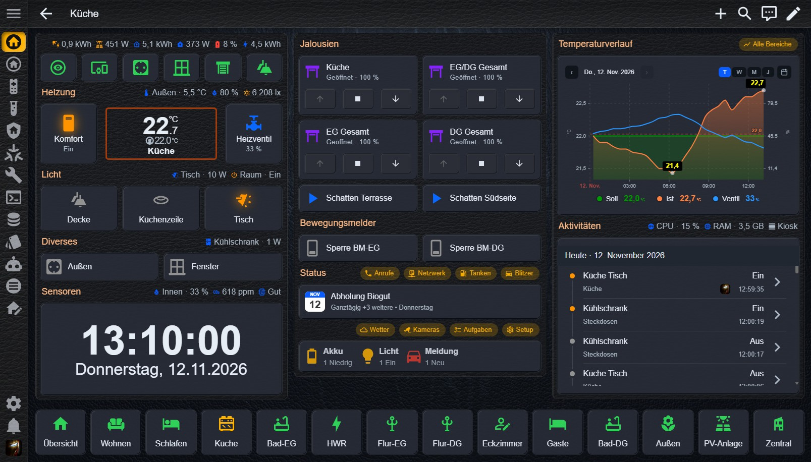
  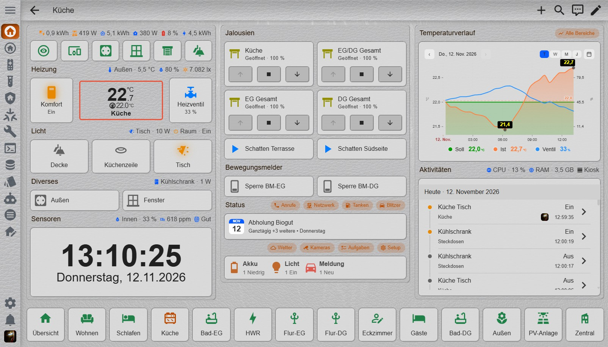

To use them, the themes must be loaded when Home Assistant starts (see [installation instructions](#installation-instructions)).

As the themes make extensive use of the UIX extension, the UIX extension must be installed to achieve the intended look (see installation instructions).
It will work without UIX, but will then simply look like a standard HA theme with a different color scheme. The themes are aimed at anyone who doesn’t want to style everything manually but still wants an attractive, consistent look.

Special thanks go to Piranha1605 for his HATG (https://github.com/Piranha1605/ha-theme-generator) and Lint-Free-Technology for the UIX extension (https://github.com/Lint-Free-Technology/uix).
Without them, this collection of themes would never become reality.

[🏠 Home](#awesome-theme-collection)

## Installation instructions

Please follow the steps below carefully to ensure everything works smoothly!

### 1. Home Assistant configuration

- The integration is deliberately designed **not** to modify your `configuration.yaml`. You must therefore add the following entry manually. If the entry already exists, please skip to step 2.
To ensure Home Assistant can use the installed themes, add the following to your `configuration.yaml`:

    frontend:
      themes: !include_dir_merge_named themes

- After changing `configuration.yaml`, restart Home Assistant.

### 2. Install the UIX extension

- If the UIX extension is already installed and the UIX settings have been configured under ‘Experimental settings’, please skip to step 3.

- Search for `uix` in the Marketplace and install the UIX extension (`https://github.com/Lint-Free-Technology/uix`).

- Open Integration and then click on the ‘cog’ (Configure).

- Select `Experimental settings` and tick `Always patch ha-card` and `Style frame panels loaded as iframe` (this is necessary to ensure that all parts of the theme work as they should)

### 3. Installing the Awesome Theme Collection

  

or

1. Search for **Awesome Theme Collection** in the Marketplace.
2. Download and install the integration (‘Reload themes’ will run automatically after installation).
3. Various [settings](settings) can be configured in the integration settings.
4. Go to **Profile** (User) and, under “Design”, select the desired design and the desired “Design mode”

The integration automatically creates the necessary directories for the themes (`/config/themes/`) and for the wallpapers (`/config/www/wallpaper/`).

### 4. Have fun

I certainly hope that some of you will enjoy it as much as I do.

[🏠 Home](#awesome-theme-collection)

## Settings

Various changes can be made in the integration settings. There are 3 sub-menus.

- Enable/disable sections
- Awesome Metal Themes
- Awesome Leather Themes

Selecting an option opens the corresponding dialog box.

## Enable/disable sections

- Here, an entire theme section can be enabled or disabled. This means that if **‘Awesome Metal Themes’ or ‘Awesome Leather Themes’** is disabled, all corresponding themes and background images will be disabled (removed from the public area).

- The themes and backgrounds are made available again once enabled; this means they are not completely deleted when disabled and remain available at any time in the integration settings (provided the integration is not uninstalled).

## Awesome Metal Themes

All settings relating to the metal themes are configured here and are independent of the other sections.

### Selection

- Here, individual **themes from this section can be enabled or disabled.** Only the themes are removed from the public area. The corresponding background images remain available for the other themes.

### Backgrounds

- Here you can set the **image and color backgrounds for the dashboard and pop-up backgrounds (dialogs, bubble card pop-ups)** (or a combination of both).

- All images stored in `/config/www/wallpaper/` are available. This means you can also copy your own images into this directory, which will then appear in the relevant selection.
I’ve already added a **few extra backgrounds to the selection** (labelled _dark and _light as appropriate).

- The section is divided into **“Dashboard” and “Pop-ups”**, each with an image and color selection for **“Dark” and “Light”-Mode**.

- For example, “Dashboard Image – Dark” and “Dashboard Color – Dark” combine the dashboard image background and dashboard color background for the “Dark” design mode. These two settings are always combined.
The same applies to the other fields in exactly the same way.

- Under ‘Image selection’, you can also choose ‘Transparent’ (if you do not want a background image). Alternatively, you can set the alpha value to 1 in the rgba values (the color will then be 100% opaque).

**Only change the color value and linear gradient if you know what you’re doing, as I cannot guarantee that all incorrect entries will be caught.**

**If you are using a linear gradient generator, please copy only the gradient itself. That is, without ‘background: ’ at the start and without ‘;’ at the end, as otherwise the value will be rejected as invalid.**

- Only **one linear gradient is permitted**, although **more intermediate values are possible**, as well as a different angle for the gradient and percentage positions.
This already allows for quite a few wild combinations of image and color backgrounds.

- When choosing the background image and background color, please ensure that readability is maintained (therefore, only select images and colors that are suitable for the area).

- The changes are applied by clicking **‘OK’**. If an incorrect value is entered, a "red error message" appears in the dialog box and the value is reset to its default value.

If **‘Reset to default backgrounds’** is enabled, **clicking ‘OK’ will restore the default settings for image backgrounds.**

If **"Reset to default colors"** is enabled, **clicking "OK" will restore the default settings for the color values.**

*All settings here apply only to the backgrounds and colors of the metal themes.*

### Sections

- Here you can set the section spacing for **horizontal and vertical spacing between sections** . Values between 0–50px are possible. However, I would not recommend setting the values to 0, as the sections will then be right up against one another.

- You can also specify a border color.
**However, the border color is only active if a background has been set for the relevant section.**

- You can set an **image and color background for sections**. All images from the ‘wallpaper’ directory are available. If you do not wish to use an image background, either select ‘Transparent’ as the image or set the opacity in the linear gradient to 1.
  A linear gradient (including one with multiple intermediate values) can be set as the color background.
  Both background fields are available for both dark and light mode.

- If the **'Background always active' switch** is set to 'On', an image or colored background will always be applied behind each section, even if no background has been set in the section settings.

Changes are applied by clicking **“OK”**. If an incorrect value is entered, a "red error message" appears in the dialog box and the value is reset to its default value.

If **“Reset to default”** is enabled, **clicking “OK” will restore the default settings in this section.**

### Cards

- Here you can set the **card radius for all cards**. This applies to all HA cards, bubble cards, mushroom cards and other custom cards. This ensures a consistent card design. Bubble cards normally have a significantly larger radius (28px).
If you wish, you can also adjust all other cards accordingly.

- **Control buttons with card background** means that the controls (cover control buttons, bubble sub-control buttons, mushroom control buttons) will also adopt the card style.

If **"Reset to default"** is enabled, **clicking "OK" will restore the default settings in this section.**

### Sidebar

The following settings are available for the sidebar.

- Set a **custom title** at the top of the sidebar (default: Home Assistant). A maximum of 20 characters is permitted.

- **Item font size** for not selected items (default: 18px) and Selected item font size (default: 20px). Adjustable from 14px to 24px.

- **Item text color** for not selected items in dark mode and Selected item text color for the selected item in dark mode.

- Item text color for not selected items in light mode and Selected item text color for the selected item in light mode.

- **Image and color background in dark mode** (the same conditions apply as for the other fields for selecting the image and color background)

- **Image and color background in light mode** (the same conditions apply as for the other fields for selecting the image and color background)

- the selected backgrounds are automatically used on the notifications page as well

If **"Reset to default"** is enabled, **clicking "OK" will restore the default settings in this section.**

### Header Toolbar

The following settings are available for the header toolbar.

- **Item font size** for not selected items (default: 18px) and Selected item font size (default: 20px). Adjustable from 14px to 24px.

- **Item text color** for not selected items in dark mode and Selected item text color for the selected item in dark mode.

- Item text color for not selected items in light mode and Selected item text color for the selected item in light mode.

- **Image and color background in dark mode** (the same conditions apply as for the other fields for selecting the image and color background)

- **Image and color background in light mode** (the same conditions apply as for the other fields for selecting the image and color background)

If **"Reset to default"** is enabled, **clicking "OK" will restore the default settings in this section.**

### Icons

- Here you can set the **icon size and icon color** (if disabled). This applies, for example, to entity icons, sidebar icons, header bar icons and form icons.

- The size can be selected between 16 and 36px (default: 24px). For button cards, only the minimum size is adjusted to the set icon size, as button cards dynamically adjust the icon size depending on the card’s size.

- The **"Icons with a glow"** toggle causes all icons with the "On" status to have a glow in the status color, e.g. switched-on lamps, sockets, switches, etc.

- The icon color only applies when the feature is disabled and can be set separately for dark and light modes.

If **"Reset to default"** is enabled, **clicking "OK" will restore the default settings in this section.**

### Font sizes

- You can set the **global font sizes** here. Wherever these standard font sizes are used, the font size you have set will be applied.
Values between 8 and 46px are permitted (**selecting sizes that are too large may cause display issues**)

The standards and their intended uses are:
- font-size-xs (small status indicators, brief notes, compact labels), font-size-s (secondary text, subtitles, timestamps, small captions),
- font-size-m (normal text, standard labels, entity names), font-size-l (emphasised text, important status information, map headings)
- font-size-xl (larger headings, section titles), font-size-2xl (main headings, prominent values)
- font-size-3xl (large headings, important measured values), font-size-4xl (very large key figures, temperature or energy consumption)
- font-size-5xl (particularly prominent numbers, e.g. on a wall-mounted display)

If **"Reset to default"** is enabled, **clicking "OK" will restore the default settings in this section.**

### Font colors

- Here you can set the **global font colors**. Wherever these default colors are used, the color you have set will be applied.
This section is divided into colors for dark mode and light mode. **Only change the colors so that they remain legible.**

- You can set the primary-text-color (e.g. labels), secondary-text-color (e.g. status messages), disabled-text-color and heading-text-color (e.g. section headings)
This section is divided into two groups: the four customisable colors for dark mode and the four customisable colors for light mode.

If **‘Reset to default’** is enabled, **clicking ‘OK’ will restore the default settings in this section.**

### Primary colors

- Here, you can adjust the primary and accent colors (for dark and light modes). The primary color is used, for example, for the borders and backgrounds of certain control elements. The accent color is used, for example, for certain buttons or active elements.

*All settings here apply only to all sections of the Metal themes.*

## Awesome Leather Themes

All settings are the same as in the Awesome Metal Themes section. See [**Awesome Metal Themes**](#awesome-metal-themes)

*All settings here apply only to all leather themes.*

[🏠 Home](#awesome-theme-collection)

## Support

- If you like my work, please give my repository a ⭐ on GitHub.
- If you find a problem or have a suggestion for improvement, please open an issue in the GitHub repository.

## Changes

v1.3.0

Further new customisation options have been added:

- In the ‘Sections’ section, you can set an image or color background (linear gradient) for the sections. Separately for dark and light mode.
The ‘Background always active’ toggle ensures that a background is always applied behind each section, even if no background is selected in the section’s settings.

- In the new ‘Cards’ section, you can now set the global card radius (for all HA cards, bubble cards, mushroom cards and other custom cards). There is also a new toggle, ‘Controls with card background’, which, as the name suggests, places the card background behind the controls as well (e.g. cover controls, bubble sub-buttons, mushroom control buttons).

- The following settings can be configured in the new ‘Sidebar’ section.
1. Set your own title in the header (instead of ‘Home Assistant’).
2. Set the font size for the entries (separately for unselected and selected items).
3. The text color for the entries (separately for unselected and selected items) for both dark and light modes.
4. An image or color background (linear gradient) for the sidebar for both dark and light modes.

- The following settings can be configured in the new ‘Header’ section (Header Toolbar).
1. The font size for the items (separately for unselected and selected items).
2. The text color for the items (separately for unselected and selected items), for both dark and light modes.
3. An image and color background (linear gradient) for the header, separately for dark and light modes.

- the selected sidebar backgrounds are automatically used on the notifications page as well

- In the ‘Icons’ section, there is a new toggle ‘Icons with glow’, which causes icons with the ‘On’ status to display a glow in their status color, e.g. switched-on lamps, sockets, switches, etc.

v1.2.0

The range of personalisation options has been significantly expanded once again:

- the default font sizes can be changed (font-size-xs, font-size-s, font-size-m, font-size-l, font-size-xl, font-size-2xl, font-size-3xl, font-size-4xl, font-size-5xl),
  and the font size will be adjusted wherever these defaults are used. If the font size selected is too large for the intended purpose, this may lead to display issues.

- The standard font colors can be changed (primary-text-color, secondary-text-color, disabled-text-color, heading-text-color)
  These default colors are used, for example, for labels (primary text color) or status messages (secondary text color). The heading color is used, for example, for section headings.

- The icon size and icon color (if disabled) can be adjusted for dark and light modes.
  The icon size is used wherever the standard icon (ha-icon) is displayed, e.g. on tile cards, in the sidebar, header bar and forms. The adjustable range is between 16 and 36px (default: 24px).

- Mushroom cards and bubble cards now also adopt the font sizes and font style of the standard HA cards.

- For the sidebar, the font size for the labels has now been changed from `font-size-m` to `font-size-l` (for better readability), and the font size for the message count (badge) has also been increased.

- The primary and accent colors can be customised (for dark and light mode respectively)

- The card radius can be set between 0 and 28px (default: 10px). This applies to all ha cards, bubble cards, mushroom cards and other custom cards whose design can be customised.
  At the same time, the controls (sub-buttons, etc.) automatically adjust to the selected radius.

- When the integration is uninstalled, all files are now actually removed

- The Awesome Theme Collection can now also be found in the HACS-/Marketplace catalogue

v1.1.0
- Different image backgrounds (including your own) are now available (configurable via the integration settings), separately for the metal and leather themes,
  separately for the dashboard and pop-ups (HA dialogues, bubble card pop-ups), for both ‘Light’ and ‘Dark’ modes. 
  (copy your own images to /config/www/wallpaper/) I’ve already added a few extra backgrounds to the selection (labelled _dark and _light as appropriate).

- Multi-level color gradients are also available as backgrounds, separately for the dashboard and pop-ups (HA dialogs, bubble card pop-ups), for both ‘Light’ and ‘Dark’ modes. 
  The image background can also be retained if an alpha value of less than 1 is set in the color gradient or if an optional transparent background has been selected.

- In addition, an entire set of themes can be deactivated (Metal and Leather themes); however, these are only removed from the public area and can be reactivated at any time

- Another new feature is an additional section where the spacing between sections and the border color for sections can be set separately in both theme areas

- Even more system dialog boxes now feature theme styling

v1.0.5
- adds a subtle border to sections when a background is set

- state-active-color (light) corrected

v1.0.4
- no more error messages in the log after a restart

- "reload designs" is now carried out automatically after installation/uninstallation

v1.0.3
- new metal background

- screenshots updated

v1.0.2
- more colors fixes, transparency values partially adjusted, more dialog boxes with a dashboard background

v1.0.1
- some color fixes for HA-Cards, Bubble-Cards, Mushroom-Cards

v1.0.0
- first release (8 UIX-Themes with Light & Dark Section)

[🏠 Home](#awesome-theme-collection)
